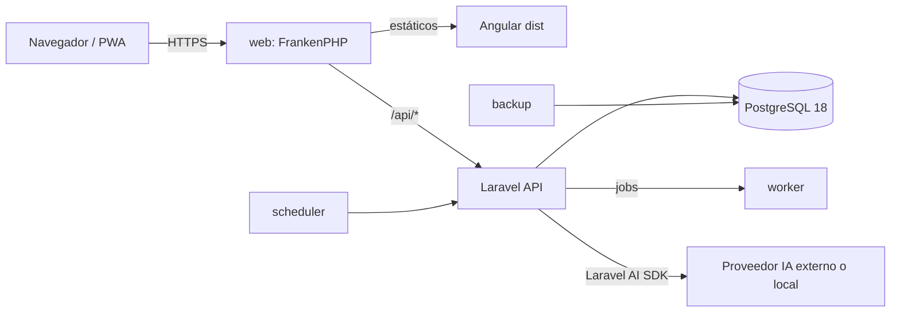

# Requerimientos técnicos – App personal de finanzas

13/10/2026 · Complementa a `PRD-app-finanzas.md`

## 1. Resumen

Monorepo con una SPA Angular (PWA) y una API Laravel, desplegados con Docker Compose idéntico en local y producción salvo overrides. PostgreSQL como única dependencia de datos: sin Redis, colas y caché en base de datos. La IA (voz y foto) se integra con Laravel AI SDK y proveedor configurable.

## 2. Stack y versiones

| Componente | Versión | Notas |
| --- | --- | --- |
| PHP | 8.5 | Laravel 13 soporta PHP 8.3–8.5 |
| Laravel | 13.x | Última major, publicada el 17/03/2026 |
| Laravel AI SDK | `laravel/ai` (última estable) | Agentes con salida estructurada, adjuntos de imagen y transcripción |
| Laravel Sanctum | Última estable | Autenticación SPA por cookie |
| PostgreSQL | 18.x | 19 sigue en fase beta/RC a fecha de este documento; actualizar cuando sea GA y tenga al menos una minor (19.1) |
| Node.js | LTS activa | Solo para build del frontend |
| Angular | 22.x | Última major (junio 2026); Angular pasa a una major al año |
| yukit-web | Fijar versión exacta | Librería pre-1.0 (0.0.x): ver riesgos |
| Testing backend | Pest | Con fakes del AI SDK |
| Testing frontend | Vitest | Runner por defecto en Angular actual |

Regla de versiones: fijar versiones exactas en `composer.lock`, `package-lock.json` y tags de imágenes Docker (nunca `latest`).

## 3. Arquitectura



- **Mismo dominio** para SPA y API: evita CORS y permite cookies de sesión de Sanctum.
- **FrankenPHP** sirve la build de Angular, ejecuta Laravel y gestiona HTTPS automático (Caddy integrado). Un único contenedor web en vez de nginx + php-fpm.
- **Sin Redis**: con un solo usuario, `database` como driver de colas, caché y sesión es suficiente. Menos piezas que mantener.

## 4. Docker Compose

### 4.1 Servicios

| Servicio | Imagen | Local | Prod | Función |
| --- | --- | --- | --- | --- |
| `web` | Propia (FrankenPHP + PHP 8.5) | Sí | Sí | API Laravel + estáticos Angular + TLS |
| `worker` | Misma que `web` | Sí | Sí | `php artisan queue:work` |
| `scheduler` | Misma que `web` | Sí | Sí | `php artisan schedule:work` (fijos, limpieza, backups) |
| `db` | `postgres:18.x` (tag exacto) | Sí | Sí | Base de datos, volumen persistente |
| `frontend` | `node:<lts>` | Sí | No | `ng serve` con hot reload y proxy a `/api` |
| `backup` | Contenedor con `pg_dump` programado | No | Sí | Copia diaria cifrada fuera del servidor |
| `mailpit` | Opcional | Sí | No | Solo si se añaden notificaciones por email |

### 4.2 Ficheros

```
compose.yaml            # base común: web, worker, scheduler, db
compose.override.yaml   # local (se aplica automáticamente): frontend, bind mounts, puertos, Xdebug
compose.prod.yaml       # prod: imágenes construidas, backup, restart, healthchecks, sin puertos de db
```

- Local: `docker compose up`.
- Prod: `docker compose -f compose.yaml -f compose.prod.yaml up -d`.

### 4.3 Requisitos

- **Dockerfile multi-stage:** etapa Node para `ng build`, etapa Composer para dependencias sin dev, etapa final FrankenPHP con el código y el `dist` de Angular.
- **Una sola imagen** para `web`, `worker` y `scheduler`; cambia solo el comando.
- **Healthchecks** en `web` (`/up` de Laravel) y `db` (`pg_isready`); `depends_on` con `condition: service_healthy`.
- **Secretos** en `.env` fuera del repositorio; `.env.example` versionado. Las claves de IA nunca en la imagen.
- **db sin puerto expuesto** en prod; solo red interna de Compose.
- **Migraciones** en el arranque del despliegue (`php artisan migrate --force`), no en el entrypoint de `worker`/`scheduler` para evitar carreras.
- **Volúmenes nombrados:** datos de Postgres y `storage/app` (ficheros temporales de audio/foto).

## 5. Backend (Laravel 13)

### 5.1 Estructura

- API REST JSON bajo `/api/v1`, con API Resources para las respuestas y Form Requests para la validación.
- Lógica de dominio en clases de acción (`app/Actions`) testeables sin HTTP, p. ej. `RegisterTransfer`, `SettleCreditCard`, `GenerateRecurringTransactions`.
- Agentes de IA en `app/Ai/Agents`.

### 5.2 Modelo de datos

| Regla | Detalle |
| --- | --- |
| Importes | `bigint` en céntimos; nunca `float` ni `decimal` en PHP |
| Fechas de movimiento | Tipo `date` (no `timestamp`); zona `Europe/Madrid` |
| Traspasos | Un registro de traspaso con dos patas (origen y destino) en la misma transacción de BD |
| Tipos de movimiento | Enum PHP respaldado + `CHECK` en Postgres |
| Saldos | Calculados a partir de movimientos; si hay problemas de rendimiento, vista materializada o columna cacheada recalculable |
| Fijos | Restricción única `(plantilla_id, periodo)` para que la generación sea idempotente |
| Borrado | Soft deletes en cuentas y movimientos |
| Integridad | Claves foráneas y restricciones en BD, no solo validación en PHP |

### 5.3 Autenticación

- Sanctum en modo SPA (cookie de sesión + CSRF), mismo dominio.
- Usuario único creado con un comando Artisan (`app:create-user`); sin endpoint de registro.
- Rate limiting en login. Sesión persistente ("recordarme") para no reautenticar en el móvil.

### 5.4 Tareas programadas

| Tarea | Frecuencia | Descripción |
| --- | --- | --- |
| Generar fijos | Diaria, 06:00 | Crea movimientos de plantillas con fecha ≤ hoy; idempotente |
| Limpiar adjuntos | Diaria | Borra audio/foto de borradores confirmados o descartados |
| Backup | Diaria | Si no lo cubre el servicio `backup` |

## 6. IA con Laravel AI SDK

### 6.1 Flujo

1. El frontend sube audio o foto a `POST /api/v1/captures`.
2. **Voz:** `Transcription::fromUpload()` obtiene el texto; después un agente con salida estructurada extrae los campos.
3. **Foto:** el mismo agente recibe la imagen como adjunto y extrae los campos directamente.
4. La API devuelve un **borrador** (no se guarda como movimiento confirmado).
5. El usuario corrige y confirma en `POST /api/v1/transactions`.

### 6.2 Agente `TransactionExtractor`

- Implementa `HasStructuredOutput`. Esquema: `type`, `amount_cents`, `date`, `description`, `merchant`, `category_id`, `account_id`, `confidence` por campo.
- El prompt recibe la lista de cuentas y categorías del usuario para que devuelva IDs válidos, más la fecha actual.
- La respuesta se valida en el servidor: IDs existentes, importe > 0, fecha no futura salvo traspaso programado.
- Timeout explícito; si falla, se devuelve un borrador vacío con el texto transcrito para completarlo a mano.

### 6.3 Proveedores

Anthropic no ofrece transcripción en el SDK. Si se usa para extracción, la voz necesita otro proveedor de STT.

| Opción | STT (voz) | Extracción (texto + imagen) | Privacidad | Coste |
| --- | --- | --- | --- | --- |
| A. Un proveedor | OpenAI o Gemini | El mismo | Datos salen del servidor | Por uso |
| B. Mixto | OpenAI, Mistral o Groq | Anthropic u OpenAI | Datos salen del servidor | Por uso |
| C. Local | Servidor Whisper con API compatible con OpenAI | Modelo con visión servido con API compatible con OpenAI | Total | Hardware (GPU) |

- El proveedor y el modelo se definen en `config/ai.php` y `.env`, nunca en el código, para poder cambiar entre A, B y C.
- Configurar failover entre proveedores solo si se usa un proveedor externo.

### 6.4 Tests

- `Transcription::fake()` y `TransactionExtractor::fake()` en todos los tests; `preventStray*` para que ningún test llame a un proveedor real.
- Un conjunto pequeño de tickets y audios reales anonimizados para evaluar manualmente la precisión antes de cambiar de modelo.

## 7. Frontend (Angular 22 + yukit-web)

### 7.1 Requisitos

- Standalone components, signals y control flow moderno; sin NgModules propios.
- PWA con `@angular/pwa`: manifest, iconos e instalación. El service worker solo cachea assets estáticos; las llamadas a la API van siempre a red (no hay modo offline).
- yukit-web como librería de componentes. Lo que no cubra se implementa con componentes propios sobre sus estilos, sin mezclar otra librería de UI.
- Cliente HTTP con interceptor para CSRF de Sanctum (`withCredentials`) y manejo de 401 → login.
- Proxy de desarrollo (`proxy.conf.json`) de `/api` y `/sanctum` hacia `web`.

### 7.2 Captura

| Entrada | Implementación | Notas |
| --- | --- | --- |
| Voz | `MediaRecorder` → subir blob | iOS genera audio MP4/AAC: el proveedor de STT debe aceptarlo |
| Foto | `<input type="file" accept="image/*" capture="environment">` | Más robusto en iOS que `getUserMedia`; redimensionar a ≤ 1600 px y comprimir en cliente antes de subir |
| Manual | Formulario con valores por defecto | Debe funcionar siempre, aunque la IA no esté disponible |

Cámara y micrófono exigen HTTPS también en local: usar el certificado local de FrankenPHP/Caddy para probar en el móvil.

## 8. Seguridad y operación

- HTTPS obligatorio; HSTS en producción.
- Acceso recomendado a través de VPN (p. ej. Tailscale) o, si se expone a internet, rate limiting y bloqueo de IPs tras intentos fallidos.
- Backups: `pg_dump` diario, cifrado, copia fuera del servidor, retención de 30 días. Probar una restauración al menos una vez.
- Logs a stdout (`LOG_CHANNEL=stderr`) para leerlos con `docker compose logs`.
- Actualizaciones: revisar mensualmente las imágenes base y dependencias (`composer outdated`, `npm outdated`).

## 9. Calidad y CI

- Backend: Pest, PHPStan/Larastan (nivel alto), Pint.
- Frontend: Vitest, ESLint, Prettier.
- CI (GitHub Actions u otro): lint + tests + build de la imagen en cada push; despliegue manual o por tag.

## 10. Riesgos técnicos

| Riesgo | Impacto | Mitigación |
| --- | --- | --- |
| yukit-web en versión 0.0.x, publicada hace pocas semanas | API inestable; puede no declarar compatibilidad con Angular 22 | Verificar `peerDependencies` antes de empezar; fijar versión exacta; encapsular sus componentes en wrappers propios en las pantallas críticas |
| Laravel AI SDK evoluciona rápido | Cambios de API entre versiones | Fijar versión; aislar su uso en `app/Ai` |
| Anthropic sin STT | La voz no funciona si solo se configura Anthropic | Proveedor de STT separado (sección 6.3) |
| PostgreSQL 19 aún no GA | Inestabilidad si se adopta pronto | Empezar en 18 y migrar con `pg_upgrade` o dump/restore |
| Dos bases de código (Angular + Laravel) para un proyecto personal | Más mantenimiento que una solución monolítica | Aceptado por preferencia de stack; mantener la API pequeña y estable |

## 11. Decisiones pendientes

- [ ] Proveedor de IA: opción A, B o C de la sección 6.3.
- [ ] Hardware de producción (VPS o NAS) y si tiene GPU.
- [ ] Registro de imágenes: build en el servidor o en CI con push a un registry.
- [ ] Retención de audios y fotos: borrar al confirmar (propuesto) o guardar como justificante.

## Fuentes

- [Laravel AI SDK – documentación oficial](https://laravel.com/docs/ai-sdk.md)
- [Laravel – soporte de versiones (endoflife.date)](https://www.endoflife.date/laravel)
- [Laravel versions (Benjamin Crozat)](https://benjamincrozat.com/laravel-versions)
- [PostgreSQL 19 Beta 4](https://www.postgresql.org/about/news/postgresql-19-beta-4-released-3386/)
- [Angular – ciclo de versiones (versionlog)](https://versionlog.com/angular/)
- [yukit-web en libraries.io](https://libraries.io/npm/yukit-web)
